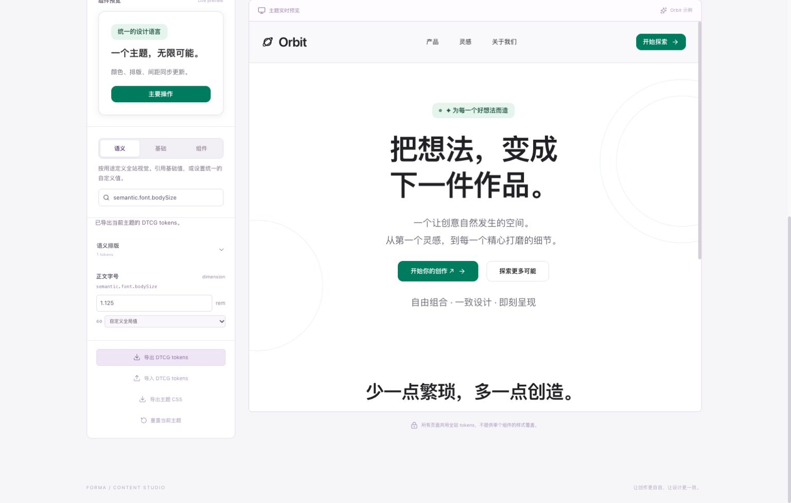
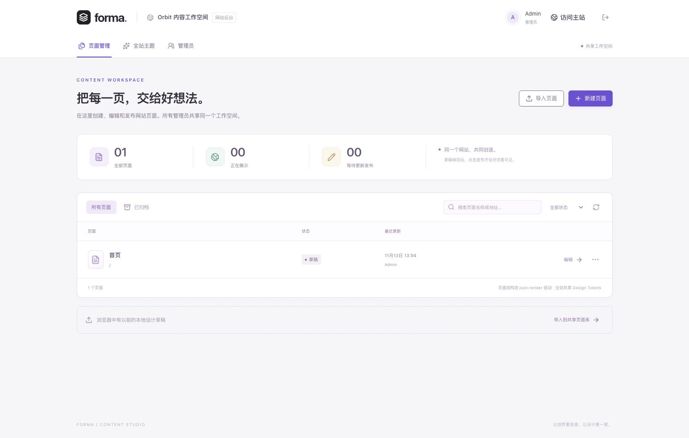

# 单网站、多管理员后台

2026-11-13 用户确认：同一个网站可以有多个管理员，管理员共同管理并自行发布页面。这里没有按客户划分的租户或独立网站；所有管理员共享页面、主题和管理权限。

## 页面、主题和发布

每个页面保存一份 json-render spec；主题属于网站，不属于单个页面。

| 数据 | 保存位置 | 何时影响访客 |
| --- | --- | --- |
| 页面草稿：标题、slug、spec、revision | 服务端 SQLite | 发布该页面后 |
| 页面已发布快照 | 服务端 SQLite | 首页 `/` 或其他页面 `/<slug>` 读取该快照 |
| 全站主题草稿：v2 DTCG 主题、revision | 服务端 SQLite | 发布全站主题后 |
| 全站已发布主题 | 服务端 SQLite | 所有公开页面共享 |
| 原本地编辑器草稿 | 浏览器 `localStorage` | 仅 `/local`，需导入后台并发布 |

保存页面不改变线上页面。发布把指定草稿版本复制到线上快照；修改草稿 slug 时，旧的已发布 URL 继续有效，直到再次发布或下线。发布全站主题会统一改变所有线上页面的颜色、排版、间距、圆角、控件尺寸、阴影和动效，不需要逐页重新发布。

归档是可恢复操作，会将页面移出正常列表并下线；恢复后仍为草稿，需要再次发布。复制页面创建独立草稿，不复制其线上发布状态。

## 主站与后台地址

- `/` 显示内部地址为 `home` 的已发布页面。原有首页草稿和发布数据无需迁移；页面名称可以修改，是否为首页由地址 `home` 决定。
- 其他页面直接使用各自地址，例如 `about` 对应 `/about`，不再生成 `/p/` 前缀。
- `/admin` 及其子路径属于管理后台，`/api` 属于接口，`/local` 保留本地编辑器，`/assets` 属于构建资源；`p` 保留用于旧链接兼容。创建或修改页面地址时不能使用 `admin`、`api`、`local`、`assets`、`p`。
- `/p/home` 与 `/home` 重定向到 `/`；旧的 `/p/about` 等地址重定向到 `/about`，查询参数继续保留。新界面与发布提示只展示正式地址。
- 路由调整不会自动发布草稿。首页尚未发布、页面已归档或页面不存在时，访客看到未发布/找不到页面状态，不会进入后台登录页。
- 后台顶部的「访问主站」在新标签页打开 `/`；页面列表的查看链接打开该页当前已发布的地址。

## 多人编辑

页面保存与发布携带读取时的 `revision`；主题操作携带 `themeRevision`。服务器发现版本已变化时返回 HTTP 409，阻止旧版本覆盖新版本。此机制不会自动合并两位管理员的编辑，也不提供实时光标或编辑锁。

遇到版本冲突时，先导出自己未保存的设计作为备份，再重新加载服务端版本，确认如何合并内容。不要通过去掉版本字段或强制覆盖绕过检查。

## 账号

空数据库首次打开后台进入初始化，创建网站和第一位管理员。初始化完成后没有公共注册入口，登录后的管理员可以创建其他管理员；管理员均具有相同权限。

密码使用服务端散列保存，登录使用 HttpOnly Cookie 会话。退出登录使当前会话失效。新增管理员不会自动发送邮件；账号信息由创建者自行交付。目前没有邮件邀请、找回密码或细分角色。

密码长度为 12–128 个字符；姓名、网站名与页面标题最多 100 个字符。页面路径使用最多 80 个字符的小写字母、数字和单连字符，例如 `about-us`。登录会话有效期为 7 天；修改密码后旧会话失效，当前浏览器获得新会话。

## 视觉约束

页面使用受控 json-render catalog 与项目自己的 React Aria 基础组件。服务器在接受页面时重复验证树结构与组件属性，拒绝 `style`、`className`、`UNSAFE_style`、任意事件和 render props 等入口。开发者在组件源码中使用 CSS，不代表设计文档可以提交 CSS。

网站主题采用 86 个固定路径的 DTCG tokens，分为基础、语义、组件三层。组件层调整整个网站中的按钮、输入框或卡片类型，不构成单个实例的样式入口。主题值、类型、单位、范围与别名都经过严格校验；不接受未知 token 或任意 CSS 字符串。完整范围见 [design-tokens.md](design-tokens.md)。

后台主题草稿与公开主题是两份独立状态。主题面板的编辑或 DTCG 导入先改变本地未保存内容，保存后进入网站草稿；只有发布主题才改变访客看到的样式。页面编辑器使用网站草稿主题预览，公开页面使用已发布主题。

## 文档与数据迁移

当前完整项目和应用主题均为 `version: 2`。导入旧 `version: 1` 项目时，会验证并将其旧主题转换为受控 DTCG 格式；页面 spec 保持原结构。后台导入不会将文件中的主题保存为页面私有主题，页面始终沿用网站主题。纯 DTCG 文件在全站主题面板导入，不包含页面 spec，也不包含应用的 mode、preset 或 version。

服务启动时通过 SQLite 事务将旧网站的草稿主题与已发布主题分别升级，成功后记录 `PRAGMA user_version = 2`。迁移不会发布草稿，也不修改页面内容、账号、发布快照、主题修订号或更新时间；失败会回滚事务。已有 v2 数据再次启动不会重复转换。旧浏览器草稿仍从原存储键读取，经验证升级后继续保存，无需清空本地存储。具体兼容边界见 [ui-migration.md](ui-migration.md)。

## 启动和数据

```sh
bun install
bun run dev
```

开发模式使用 Vite 前端和 Bun API；前端将 `/api` 请求代理到 API 服务。首次使用时在 `/admin` 初始化网站。公开首页通过 `/` 访问，其他公开页面通过 `/<slug>` 访问。

```sh
bun test
bun run build
bun start
```

生产模式需要运行 Bun 服务，不能只部署 `dist/`。SQLite 默认路径为 `data/forma.sqlite`，应放在持久化磁盘上。备份使用 SQLite 一致性备份机制，或停止服务后备份整个数据目录；不要在写入期间仅复制主 `.sqlite` 文件而忽略 WAL 数据。

| 环境变量 | 默认值 | 用途 |
| --- | --- | --- |
| `FORMA_DB_PATH` | `data/forma.sqlite` | SQLite 文件路径 |
| `HOST` | `127.0.0.1` | API / 生产服务监听地址 |
| `PORT` | `3001` | API / 生产服务端口 |
| `FORMA_API_PORT` | `3001` | `bun run dev` 启动的 API 端口与 Vite 代理目标；开发时优先使用此项 |
| `FORMA_ORIGIN` | 根据当前请求推断 | 浏览器访问站点的完整 origin，例如 `https://example.com`；反向代理部署时显式配置 |
| `FORMA_SECURE_COOKIES` | 根据 HTTPS origin 推断 | 设置 `1` 强制会话 Cookie 使用 Secure，仅通过 HTTPS 发送 |

生产部署应先在本机完成初始化，再将站点接到公网 HTTPS 入口；配置 `FORMA_ORIGIN` 为该入口的 origin。API 拒绝跨站写入，开发代理应保留前端 Host。改变生产数据库路径会使用另一份独立数据，务必检查持久化挂载。

网页发布只更新当前服务器的公开快照。域名、HTTPS 和公网托管属于部署配置；当前项目没有已创建的 Sites 托管站点或线上 URL。

## 范围

- 管理后台路径：`/admin`；主站首页：`/`；其他公开页面：`/<slug>`；旧本地编辑器：`/local`。
- 页面内容由 React 在客户端渲染，依赖项目内的受控 catalog 与组件实现。
- 不包含多租户、实时协同、细分角色、邮件或表单数据收集。
- 示例导航和按钮仍使用示例链接，发布前应按页面用途修改受控链接内容。

## 验证方式

`bun test` 覆盖认证、持久化、多人版本冲突、页面与主题发布隔离、旧数据迁移及失败回滚、主题白名单、会话过期和主站路由。`bun run build` 执行 TypeScript 检查并生成生产资源。

浏览器回归使用独立临时数据库，检查登录与共享页面、编辑和发布、主题草稿与公开页隔离、未保存离开提醒、窄屏布局及旧链接跳转。初始化流程只适用于空数据库；已有数据库会保留其账号和页面。

当前全站主题编辑器（测试数据）：



以下为此前主站路由的功能截图，外观早于当前 DTCG 主题编辑器：


