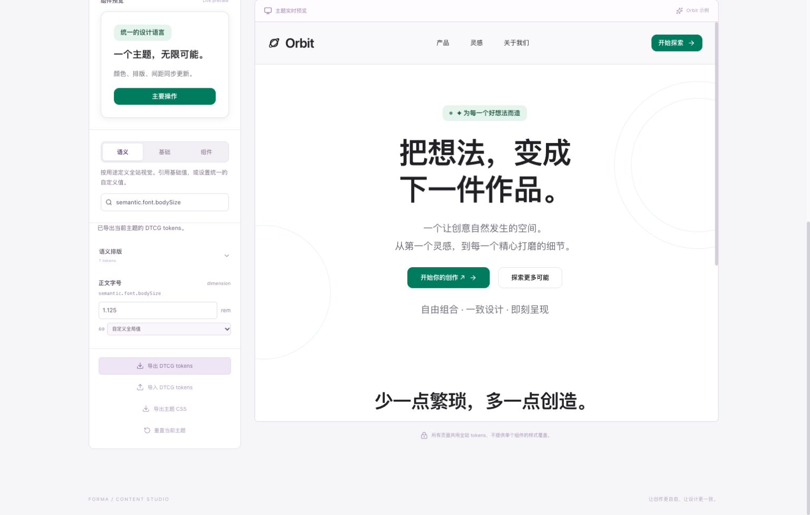

# 全站设计 tokens

Forma 使用 **DTCG 2025.10 数据格式的受控 profile** 表达全站主题，由项目自己的设计系统消费。DTCG 负责值、类型和引用的表示；语义命名与可编辑范围由项目定义，不依赖 shadcn 的字段或 CSS 变量。

当前白名单共 86 个 tokens：30 个基础值、50 个语义角色、6 个组件类型配置。编辑器、导入和服务端共用 `src/lib/tokens.ts` 的校验。用户只能调整这份全站主题，不能在页面或组件实例中写样式。

## 三层引用

| 层 | 用途 | 示例 |
| --- | --- | --- |
| `primitive` | 原始色板、尺寸、字体、动效、阴影 | `primitive.color.brand`、`primitive.dimension.radiusSmall` |
| `semantic` | 用途明确的页面角色 | `semantic.color.action`、`semantic.radius.control` |
| `component` | 全站某类组件的必要配置 | `component.button.radius`、`component.card.padding` |

默认主题使用实际引用，而非重复复制值。例如：

```text
component.button.radius
  → semantic.radius.control
    → primitive.dimension.radiusSmall
```

修改基础圆角会沿引用链影响按钮与输入框。把 `component.button.radius` 改为合法字面值后，会统一调整整个网站的按钮；该 token 不再跟随原引用，直到重新选择引用来源或恢复默认值。它不允许只修改某个按钮。

基础层只能保存字面值。语义层和组件层可使用字面值或完整引用字符串，例如 `"{primitive.color.brand}"`。引用目标必须存在、类型一致，并且处于同层或更低层；不能由语义层反向依赖组件层。解析会拒绝循环，且检查结果是否符合当前 token 的数值范围。当前不支持字符串插值或复合值内部的局部引用。

## 数据格式

应用内主题包含模式与预设信息：

```ts
type Theme = {
  version: 2;
  mode: 'light' | 'dark';
  preset: 'violet' | 'blue' | 'emerald' | 'orange' | 'neutral';
  tokens: DTCGGroup;
};
```

导出 `site-theme.tokens.json` 时只输出 `tokens` 树。以下是用于说明格式的局部片段；导入需要完整的 86 个已注册 tokens，不能将这个片段直接作为完整主题导入：

```json
{
  "primitive": {
    "dimension": {
      "radiusSmall": {
        "$type": "dimension",
        "$value": { "value": 0.625, "unit": "rem" }
      }
    }
  },
  "semantic": {
    "radius": {
      "control": {
        "$type": "dimension",
        "$value": "{primitive.dimension.radiusSmall}"
      }
    }
  },
  "component": {
    "button": {
      "radius": {
        "$type": "dimension",
        "$value": "{semantic.radius.control}"
      }
    }
  }
}
```

每个 token 明确包含 `$type` 与 `$value`，可附带最多 500 字符的 `$description`。模式、预设和文档版本属于应用封装，不会混入纯 DTCG 导出；这里未实现 DTCG Resolver 模块。

## 支持类型与边界

| `$type` | `$value` 形状 | 本项目限制 |
| --- | --- | --- |
| `color` | `{ colorSpace: "srgb", components: [r, g, b], alpha }` | 三个通道与 alpha 均为 0–1 有限数；省略 alpha 时按 1 处理 |
| `dimension` | `{ value, unit: "rem" }` | 有限数，通用上限为 8 rem；每个路径还有自己的范围 |
| `fontFamily` | 字符串或字符串数组 | 仅受控字体名称；数组含 1–5 项 |
| `duration` | `{ value, unit: "ms" }` | 0–1000 ms |
| `shadow` | `{ color, offsetX, offsetY, blur, spread }` | 单个外阴影；颜色同上，尺寸使用 rem；偏移与扩展为 −8–8 rem，模糊为 0–8 rem |

字体名称白名单为 `Inter`、`system-ui`、`sans-serif`、`Arial`、`Georgia`、`serif`、`ui-monospace`、`monospace`。主题只选择字体栈，不下载字体，不接受字体 URL。

默认正文为 `0.9375rem`、基础间距单位为 `0.25rem`、控件高度为 `2.25rem`、卡片内边距为 `1.5rem`。主要语义尺寸范围如下；完整定义以 `TOKEN_DEFINITIONS` 为准：

| 路径 | 范围（rem） |
| --- | --- |
| `semantic.radius.control` / `surface` | 0–2 |
| `semantic.space.unit` | 0.125–1 |
| `semantic.space.gap` | 0–4 |
| `semantic.space.sectionInline` | 0–6 |
| `semantic.space.sectionBlock` | 0–8 |
| `semantic.size.controlHeight` | 1.5–4 |
| `semantic.font.bodySize` / `labelSize` | 0.75–1.5 / 0.625–1.25 |
| `semantic.font.heading1Size` / `heading2Size` / `heading3Size` | 1.5–6 / 1.25–4 / 1–3 |

这是有意收窄的 DTCG 子集，不是任意 DTCG 文档的通用编辑器。当前不支持其他 token 类型、其他色彩空间、`px` 尺寸、`s` 时长、阴影数组、`inset`、组级类型继承、`$ref`、`$extensions` 或任意元数据。它们即使在更广泛的 DTCG 规范中有效，也不属于本项目的导入范围。缺失或未知路径、未知字段、CSS 字符串、非有限数、错误单位和可执行表达式都会被拒绝。

规范依据：[DTCG Format 2025.10](https://www.designtokens.org/tr/2025.10/format/)、[DTCG Color 2025.10](https://www.designtokens.org/tr/2025.10/color/)。规范中的 color alpha 可以省略并默认 1，shadow inset 可以省略并默认 false；当前生成的颜色显式保存 alpha，阴影不生成 inset。

## 注册路径

下表用 `{a,b}` 简写同一前缀下的多个独立 token，不是实际路径语法。

| 层 | 路径组 |
| --- | --- |
| 基础颜色（15） | `primitive.color.{white,black,gray50,gray100,gray200,gray500,gray900,brand,brandTint,brandInk,red,green,blue,amber,pink}` |
| 基础尺寸（7） | `primitive.dimension.{unit,gap,inset,section,control,radiusSmall,radiusLarge}` |
| 基础排版（6） | `primitive.font.{family,body,label,heading1,heading2,heading3}` |
| 基础动效与阴影（2） | `primitive.motion.normal`、`primitive.shadow.soft` |
| 语义颜色（22） | `semantic.color.{canvas,text,surface,surfaceText,raised,raisedText,action,onAction,secondary,onSecondary,subtle,muted,selected,onSelected,danger,onDanger,border,fieldBorder,focus,success,warning,info}` |
| 数据系列颜色（5） | `semantic.color.chart.{series1,series2,series3,series4,series5}` |
| 导航颜色（8） | `semantic.color.navigation.{surface,text,action,onAction,selected,onSelected,border,focus}` |
| 语义尺寸（7） | `semantic.radius.{control,surface}`、`semantic.space.{unit,gap,sectionInline,sectionBlock}`、`semantic.size.controlHeight` |
| 语义排版（6） | `semantic.font.{family,bodySize,labelSize,heading1Size,heading2Size,heading3Size}` |
| 语义动效与阴影（2） | `semantic.motion.duration`、`semantic.shadow.surface` |
| 组件配置（6） | `component.button.{radius,height}`、`component.input.{radius,height}`、`component.card.{radius,padding}` |

数据系列与导航角色为组件提供全局主题契约；存在这些 tokens 不表示项目已内置专业图表、日程或地图引擎。

## 编辑、导入与发布

主题面板提供基础／语义／组件三层切换、搜索、按类型编辑、引用来源选择和恢复当前预设默认值。预设或亮暗模式切换会替换颜色配置，同时保留非颜色配置与引用。

纯 DTCG 导入保留当前应用的 mode 与 preset，校验整棵 token 树后替换主题。后台的编辑与导入先作用于本地未保存状态，保存后成为全站主题草稿，再发布才影响所有线上页面。页面草稿预览和已发布网站分别读取草稿主题与发布主题。主题版本检查防止多人编辑时静默覆盖。

完整项目文件另外包含页面 spec 和主题封装。后台导入完整项目时仍沿用网站主题，不创建页面主题；`/local` 的独立项目则保存自己的整份主题。旧格式转换见 [ui-migration.md](ui-migration.md)。



## 开发 API

所有 API 位于 `src/lib/tokens.ts`：

| API | 行为 |
| --- | --- |
| `TOKEN_DEFINITIONS` | 路径、名称、分组、层、类型及可选范围／步长／单位 |
| `createTheme(preset?, mode?)` | 创建合法 v2 默认主题与别名链 |
| `themeSchema.parse(input)` | 严格验证 v2；不接受旧格式 |
| `parseTheme(input)` | 旧存储／导入边界，接受旧主题并单向升级 |
| `resolveTheme(theme)` | 验证后返回按路径索引、已完全解析的 DTCG 值 |
| `getTokenValue(theme, path)` | 返回单个已解析值的副本 |
| `getTokenReference(theme, path)` | 返回不含花括号的引用路径，字面值返回 `null` |
| `setTokenValue(theme, path, value)` | 不可变更新，重新验证整个主题；引用使用 `"{path}"` |
| `themeToStyle(theme)` | 返回 86 个已解析的 CSS 自定义属性 |
| `themeToCSS(theme)` | 导出 CSS 字符串；亮色选择器 `:root`，暗色 `.dark` |
| `themeToDTCG(theme)` | 返回纯 token 树的格式化 JSON 字符串，保留别名 |
| `tokenCSSName(path)` | 把注册路径映射到 `--ds-*` 名称 |
| `hexToColor` / `colorToHex` | 六位十六进制颜色与 sRGB 值互转；透明度单独处理 |

```ts
const theme = createTheme('violet', 'light');
const updated = setTokenValue(theme, 'semantic.radius.control', {
  value: 0.5,
  unit: 'rem',
});
const linked = setTokenValue(
  updated,
  'component.button.radius',
  '{semantic.radius.control}',
);
const values = resolveTheme(linked);
// values['component.button.radius'] 为 { value: 0.5, unit: 'rem' }
```

CSS 名称只把点替换为连字符，保留路径中的大小写，例如 `semantic.color.onAction → --ds-semantic-color-onAction`。运行时和导出均不生成旧样式变量。CSS 输出解析后的字面值；DTCG JSON 保留引用关系。当前 CSS 颜色转换按 8 位通道输出，DTCG 数据本身保留其数值。

未来 Canvas、图表或地图组件可以通过 `resolveTheme` 获取类型化数值，转换为各自库需要的选项；这里尚未实现专业组件适配器。数据 map、业务 schema 校验与 token 解析属于不同职责，不能用主题 tokens 代替业务数据契约。

## 本轮验证

2026-11-13 的模型、组件和 API 测试及 TypeScript／生产构建通过；生产构建仍提示主包较大。导出的 DTCG 文件通过官方 2025.10 JSON Schema 的独立验证，非法值对照被拒绝。

隔离数据库的浏览器验证确认：保存主题草稿不影响公开页，发布后按钮配色与正文字号同步更新；主题面板下载的 DTCG 文件可以重新解析。现有数据库在备份后完成 v2 迁移，页面数据和网站元数据保持不变，草稿与发布主题分别按旧值转换，未发布首页没有被迁移操作自动发布。
